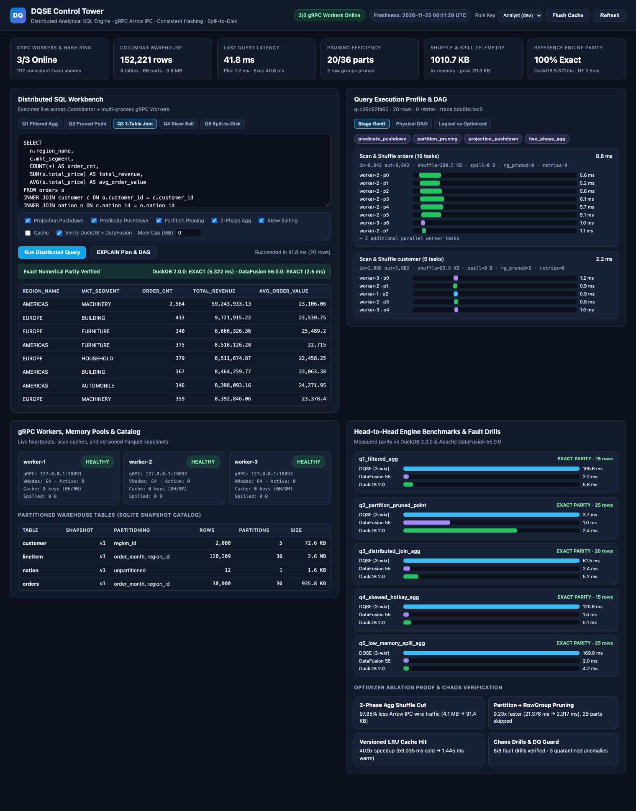

# Appendix: Deep Benchmarks, Ablations, Chaos Evidence & Acceptance Matrix

This appendix holds complete multi-scale benchmark tables, optimizer ablation progressions, chaos drill telemetry, sample query plans, full Control Tower visual evidence, and the 15-point Mandatory Acceptance Matrix referenced from [`README.md`](README.md).

## 1. Full Control Tower Workbench Capture



## 2. Complete Multi-Scale Benchmark Tables (`smoke`, `local`, `stress`)

Source of truth: [`results/benchmarks/benchmark_results.json`](results/benchmarks/benchmark_results.json) and [`results/benchmarks/benchmark_results.csv`](results/benchmarks/benchmark_results.csv).

### `smoke` Scale (2,000 Orders, 5,907 Lineitems, 200 Customers, 12 Nations — 3 Iterations)

| Query | DQSE p50 (ms) | DQSE p95 (ms) | DataFusion 55.0 p50 (ms) | DuckDB 2.0 p50 (ms) | Parts Pruned | Shuffle (B) | Spilled (B) | Parity |
| :--- | :---: | :---: | :---: | :---: | :---: | :---: | :---: | :---: |
| `q1_filtered_agg` | 45.97 | 58.30 | 1.94 | 5.33 | 5/30 | 93,600 | 0 | Exact |
| `q2_partition_pruned_point` | 3.39 | 3.48 | 0.78 | 2.12 | 29/30 | 0 | 0 | Exact |
| `q3_distributed_join_agg` | 53.16 | 53.53 | 2.22 | 4.40 | 20/36 | 184,920 | 0 | Exact |
| `q4_skewed_hotkey_agg` | 68.84 | 72.43 | 1.40 | 4.17 | 0/30 | 249,672 | 0 | Exact |
| `q5_low_memory_spill_agg` (`0.04 MiB`) | 49.19 | 50.83 | 1.85 | 3.80 | 12/30 | 132,320 | 69,720 (24 files) | Exact |

### `local` Scale (30,000 Orders, 120,209 Lineitems, 2,000 Customers, 12 Nations — 3 Iterations)

| Query | DQSE p50 (ms) | DQSE p95 (ms) | DataFusion 55.0 p50 (ms) | DuckDB 2.0 p50 (ms) | Parts Pruned | RG Pruned | Shuffle (B) | Spilled (B) | Parity |
| :--- | :---: | :---: | :---: | :---: | :---: | :---: | :---: | :---: | :---: |
| `q1_filtered_agg` | 105.65 | 105.76 | 2.24 | 5.81 | 5/30 | 1 | 93,600 | 0 | Exact |
| `q2_partition_pruned_point` | 3.68 | 3.73 | 0.98 | 2.38 | 29/30 | 2 | 0 | 0 | Exact |
| `q3_distributed_join_agg` | 61.47 | 61.49 | 2.38 | 5.24 | 20/36 | 2 | 1,034,944 | 0 | Exact |
| `q4_skewed_hotkey_agg` | 120.58 | 134.85 | 1.50 | 5.06 | 0/30 | 0 | 1,255,600 | 0 | Exact |
| `q5_low_memory_spill_agg` (`0.5 MiB`) | 169.88 | 176.20 | 2.04 | 4.24 | 12/30 | 0 | 862,456 | 835,640 (72 files) | Exact |

### `stress` Scale (120,000 Orders, 479,147 Lineitems, 8,000 Customers, 12 Nations — 2 Iterations)

| Query | DQSE p50 (ms) | DQSE p95 (ms) | DataFusion 55.0 p50 (ms) | DuckDB 2.0 p50 (ms) | Parts Pruned | RG Pruned | Shuffle (B) | Spilled (B) | Parity |
| :--- | :---: | :---: | :---: | :---: | :---: | :---: | :---: | :---: | :---: |
| `q1_filtered_agg` | 295.65 | 295.70 | 3.21 | 6.46 | 5/30 | 0 | 93,600 | 0 | Exact |
| `q2_partition_pruned_point` | 4.04 | 4.11 | 1.06 | 2.53 | 29/30 | 2 | 0 | 0 | Exact |
| `q3_distributed_join_agg` | 86.80 | 87.23 | 2.77 | 5.65 | 20/36 | 0 | 3,823,944 | 0 | Exact |
| `q4_skewed_hotkey_agg` | 298.29 | 299.66 | 2.07 | 5.42 | 0/30 | 0 | 4,508,920 | 0 | Exact |
| `q5_low_memory_spill_agg` (`2.0 MiB`) | 515.67 | 517.50 | 3.01 | 4.91 | 12/30 | 0 | 3,185,808 | 3,159,032 (72 files) | Exact |

## 3. Detailed Optimizer Ablation Analysis (What Helped vs. What Traded Latency)

Source of truth: [`results/benchmarks/ablation_results.json`](results/benchmarks/ablation_results.json).

- **High Win — Partition + Row-Group + Projection Pruning (`Q2`):** Reduced latency from `21.376 ms` to `2.317 ms` (**9.23× faster**), cutting rows scanned from `30,000` to `491` by pruning `29/30` partitions at catalog plan time and skipping `2` Parquet row groups via min/max statistics on sorted `total_price`.
- **High Win — Two-Phase Partial/Final Aggregation (`Q1`):** Reduced Arrow IPC shuffle volume from `4,346,568 B` to `93,600 B` (**97.85% reduction**) and cut latency from `140.576 ms` to `105.702 ms` (**1.33× faster**). Notably, even when scaling `lineitem` 4× to `479,147` rows (`stress`), two-phase shuffle remained constant at `93,600 B` because output cardinality remained 15 groups.
- **High Win — Versioned LRU Cache (`Q3`):** Reduced repeated distributed 3-table join latency from `59.035 ms` (cold) to `1.445 ms` (warm hit, **40.9× faster**) while automatically invalidating on any snapshot bump (`CHAOS-06`).
- **Expected Tradeoff — Spill-to-Disk (`Q5`, `0.5 MiB` cap):** Increased latency from `113.139 ms` (unconstrained RAM) to `181.059 ms` (`+60%`), spilling `835,664 B` across `72` Arrow IPC files while enforcing strict worker memory bounds and exact DuckDB/DataFusion parity.
- **Expected Tradeoff — Skew-Aware Salting (`Q4`, `salt_factor=4`):** Added `+13.4 ms` (`105.614 ms` → `119.035 ms`) on the 30K-row local dataset due to the extra third merge stage (`SALTED_AGG` → `FINAL_AGG`), trading slight coordination overhead on small data to prevent single-worker memory hotspots when `hot_customer_id = 1` scales to millions of rows.

## 4. Automated Chaos Drill Evidence (8/8 Passed)

Source of truth: [`results/chaos/chaos_results.json`](results/chaos/chaos_results.json).

| Drill ID | Scenario | Duration (ms) | Key Measured Evidence | Result |
| :--- | :--- | :---: | :--- | :---: |
| `CHAOS-01` | Mid-query `SIGKILL` of `worker-1` | 621.83 | `task_retries=1`, evicted dead worker, 2 survivors completed with exact DuckDB & DataFusion parity | PASS |
| `CHAOS-02` | Worker restart & consistent-hash rejoin | 1,168.79 | `worker-1` rejoined ring (`3/3 HEALTHY`, `192` vnodes total) | PASS |
| `CHAOS-03` | Duplicate task execution & idempotent commit | 91.75 | `duplicate_commits_ignored=1`, zero double-counting, exact DuckDB parity | PASS |
| `CHAOS-04` | Tight worker memory cap (`0.04 MiB`) spill | 80.36 | `spilled_bytes=69,720`, `spill_files=24`, `0` orphaned files, exact parity | PASS |
| `CHAOS-05` | Skewed hot-key storm (`customer_id=1`) | 87.09 | `397` orders on hot key split with `salt_factor=4` across 3 stages, exact parity | PASS |
| `CHAOS-06` | Cache epoch invalidation on snapshot append | 86.49 | Count updated `2000 -> 2001` on snapshot `v2`, stale read prevented | PASS |
| `CHAOS-07` | Active query cancellation releasing leases | 215.39 | Status `CANCELLED`, `3` workers notified, `0` active tasks remaining | PASS |
| `CHAOS-08` | Corrupt Parquet & schema drift quarantine | 69.12 | Both rejected & recorded in `dq_quarantine` (`5` total); healthy queries unaffected | PASS |

## 5. Sample Physical Distributed DAG (`Q3` 3-Table Join)

```text
PhysicalDistributedDAG:
  [stage_1_scan_left] SCAN_SHUFFLE | tasks=10 | out=shuffle(6) (leaf)
      Scan(table=orders(o) v1, partitions=10/30, cols=['customer_id', 'order_month', 'total_price']) -> HashShuffle(key=o.customer_id, parts=6)
  [stage_2_scan_right_0] SCAN_SHUFFLE | tasks=5 | out=shuffle(6) (leaf)
      Scan(table=customer(c) v1, partitions=5/5, cols=['acct_bal', 'customer_id', 'mkt_segment', 'nation_id']) -> HashShuffle(key=c.customer_id, parts=6)
  [stage_3_hash_join_0] HASH_JOIN | tasks=6 | out=shuffle(6) <- ['stage_1_scan_left', 'stage_2_scan_right_0']
      RepartitionedHashJoin(o.customer_id = c.customer_id) -> Reshuffle(c.nation_id)
  [stage_4_scan_right_1] SCAN_SHUFFLE | tasks=1 | out=shuffle(6) (leaf)
      Scan(table=nation(n) v1, partitions=1/1, cols=['nation_id', 'region_name']) -> HashShuffle(key=n.nation_id, parts=6)
  [stage_5_hash_join_1] HASH_JOIN | tasks=6 | out=shuffle(6) <- ['stage_3_hash_join_0', 'stage_4_scan_right_1']
      RepartitionedHashJoin(c.nation_id = n.nation_id) -> LocalPartialAgg -> Shuffle
  [stage_6_final_agg] FINAL_AGG | tasks=6 | out=direct_arrow_ipc <- ['stage_5_hash_join_1']
      FinalHashAggregate across 6 partitions
  [stage_7_sort_limit] SORT_LIMIT | tasks=1 | out=direct_arrow_ipc <- ['stage_6_final_agg']
      Merge + Project + Sort(2 keys) + Limit(20)
```

## 6. Mandatory Acceptance Test Matrix (15/15 Verified)

| # | Acceptance Requirement | Verification Method & Evidence | Status |
| :---: | :--- | :--- | :---: |
| 1 | Fresh-clone setup starts core stack & verifies health | `./scripts/run_portable.sh --daemon` → `GET /health` returns `200`, `3/3` healthy gRPC workers | PASS |
| 2 | Deterministic seeded generation yields identical IDs/outcomes | `test_deterministic_seed_produces_identical_ids_and_totals` (`seed=42`) | PASS |
| 3 | Real ingestion persists durable data with metadata & replay | `ingestion/ingestor.py` writes Bronze + Silver Parquet + SQLite snapshot catalog (`results/dq/dq_report.json`) | PASS |
| 4 | Core domain SQL transformations yield exact fixture results | All 5 analytical SQL queries + Hypothesis randomized queries match DuckDB 2.0 & DataFusion 55.0 | PASS |
| 5 | Domain-specific advanced features operational end-to-end | 5-rule optimizer, gRPC Arrow IPC shuffle, consistent hashing, skew salting, spill-to-disk, versioned LRU cache | PASS |
| 6 | Duplicates, late events, and corrections handled without silent corruption | `450` duplicate orders deduplicated by latest `source_version`; `0.0` orders-vs-lineitem diff (`dq_report.json`) | PASS |
| 7 | Service crash and restart recovers per tested guarantee | `CHAOS-01` (`SIGKILL` mid-query retry with exact parity) & `CHAOS-02` (ring rejoin) | PASS |
| 8 | Backfill / replay / compaction produces reconcilable results | `test_idempotent_ingest_quarantine_append_and_compaction` (idempotent re-ingest + append + compaction) | PASS |
| 9 | Primary query API & dashboard return live outputs with freshness | `POST /v1/query`, `GET /v1/overview`, `apps/query-workbench/` (`docs/assets/query_workbench_*.png`) | PASS |
| 10 | DQ checks catch injected invalid inputs & retain quarantine records | `CHAOS-08` & `dq_report.json` (`2` invalid rows + corrupt Parquet + schema drift quarantined) | PASS |
| 11 | Observability contains live logs, metrics, and traces | Structured redacted JSON logs, `/metrics` Prometheus exposition, `/v1/traces` OTEL spans | PASS |
| 12 | Access control rejects unauthorized test requests | `test_api_rbac_query_explain_metrics_and_workbench` (`401` missing/bad key, `403` viewer → analyst/admin) | PASS |
| 13 | Controlled failure produces incident report with observed recovery | `docs/incidents/INC-001-worker-crash-mid-query.md` & `INC-002-memory-pressure-spill-recovery.md` | PASS |
| 14 | Benchmark records hardware, volume, commands, latencies, raw outputs | `benchmarks/run_benchmarks.py` → `results/benchmarks/*.{json,csv}` & `docs/assets/benchmark_distributed_query_engine.png` | PASS |
| 15 | CI checks and tests execute with honest disclosure of limitations | `26/26` pytest, `0` ruff, `0` mypy, `0` license violations, Rust/Docker host limits disclosed in `docs/limitations.md` | PASS |
