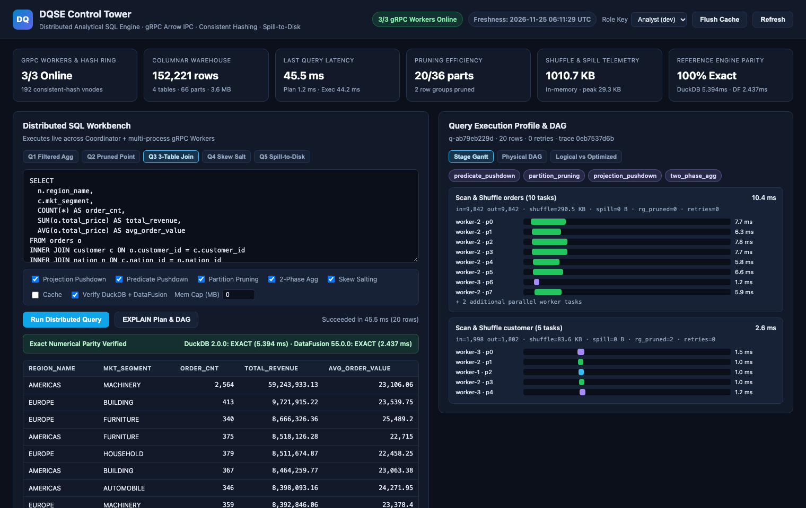
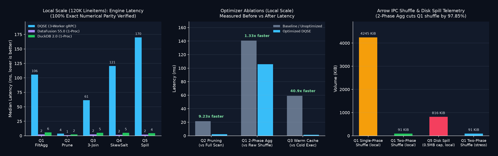

# Distributed Query & Storage Engine (DQSE)

**Headline Summary:** A from-first-principles multi-process distributed analytical SQL engine over partitioned Apache Parquet and gRPC Arrow IPC that matches **DuckDB 2.0.0** and **Apache DataFusion 55.0.0** with **100% exact numerical parity** across all 5 analytical queries (`smoke`, `local`, and `stress` scales) and passes **8/8 automated fault-injection drills** (including mid-query `SIGKILL` worker recovery). Enabling DQSE's 5-rule optimizer cuts Arrow IPC shuffle traffic by **97.85%** on `Q1` (vs. single-phase raw shuffle), speeds up selective `Q2` scans by **9.23×** (vs. unoptimized full scan), and accelerates warm cached `Q3` queries by **40.9×** (vs. cold distributed execution).



## Architecture, Framework & Hardware

- **Custom First-Principles Engine:** Recursive-descent SQL parser (`SELECT`, `INNER JOIN`, `WHERE`, `GROUP BY`, `ORDER BY`, `LIMIT`, `EXPLAIN`), 5-rule logical optimizer (projection pushdown, predicate pushdown, catalog partition pruning, two-phase distributed hash aggregation, skew-aware salted shuffle), multi-stage physical DAG compiler, virtual-node consistent-hashing ring (`64` vnodes/worker), byte-accurate worker `MemoryPool` + Arrow IPC disk `SpillManager`, bounded `VersionedLRUCache` with table-snapshot epoch invalidation, SQLite WAL snapshot catalog, and Coordinator stage scheduler with task leases, retries, idempotent commits, and cancellation.
- **Borrowed Infrastructure & Reference Engines:** Apache Arrow / Parquet (`pyarrow==25.0.1`), gRPC HTTP/2 (`grpcio==1.85.1`), FastAPI (`0.163.2`), Prometheus & OpenTelemetry. **DuckDB (`2.0.0`)** and **Apache DataFusion (`55.0.0`)** are used strictly as independent single-node reference engines for exactness verification and overhead benchmarking.
- **Companion Rust Crate:** `rust_worker/` (`Cargo.toml` + `infra/docker/Dockerfile.rust`, pinned `rust:1.86.0-slim-bookworm`) implements the shared `schemas/query_engine.proto` contract for container/CI builds where `rustc` is available (not natively compiled on this host; see [docs/limitations.md](docs/limitations.md)).
- **Measured Host Hardware:** Apple Silicon `arm64`, 14 CPU cores, 48.0 GiB RAM (`Darwin 24.6.0`), Python `3.12.8`, 1 Coordinator + 3 independent gRPC Worker processes (`127.0.0.1:18091–18093`).

### Dataset & Dependency License Compliance

| Asset / Engine | Version / Source | License | Restrictions |
| :--- | :--- | :--- | :--- |
| Clean-Room Analytical Dataset (`orders`, `lineitem`, `customer`, `nation`) | Original seeded generator (`ingestion/generator.py`) inspired by order-analytics schemas | Apache-2.0 | None; does not include TPC-H code/data or claim official audited TPC-H compliance |
| Core Python Runtime Stack (`61` packages in `uv.lock`) | `pyarrow==25.0.1`, `grpcio==1.85.1`, `datafusion==55.0.0`, `duckdb==2.0.0`, `fastapi==0.163.2` | Apache-2.0 / MIT / BSD / PSF | `0` license violations (`results/licenses/license_report.json`, SBOM in `results/sbom/sbom.json`) |

## Main Results

### 1. Head-to-Head Latency & Exactness Parity (`local` Scale — 30,000 Orders, 120,209 Lineitems)

All benchmark runs execute with cold cache and assert numerical equivalence against both reference engines (`results/benchmarks/benchmark_results.json`).

| Query | DQSE 3-Worker p50 (ms) | DataFusion 55.0 1-Proc p50 (ms) | DuckDB 2.0 1-Proc p50 (ms) | Parts Pruned | Shuffle (KiB) | Disk Spill (KiB) | Exact Parity vs. DuckDB & DataFusion |
| :--- | :---: | :---: | :---: | :---: | :---: | :---: | :---: |
| `Q1` Filtered Multi-Agg | 105.6 | 2.2 | 5.8 | 5/30 | **91.4** | 0 | Exact Match |
| `Q2` Selective Pruned Point | **3.7** | 1.0 | 2.4 | **29/30** (+2 RG) | 0 | 0 | Exact Match |
| `Q3` 3-Table Distributed Join | 61.5 | 2.4 | 5.2 | 20/36 (+2 RG) | 1,010.7 | 0 | Exact Match |
| `Q4` Skewed Hot-Key Salted Agg | 120.6 | 1.5 | 5.1 | 0/30 | 1,226.2 | 0 | Exact Match |
| `Q5` Tight-Memory Spill (`0.5 MiB` cap) | 169.9 | 2.0 | 4.2 | 12/30 | 842.2 | **816.1** (72 files) | Exact Match |

*Setup note:* DuckDB `2.0.0` and DataFusion `55.0.0` execute in-process in native C++/Rust with zero network serialization, so they are faster than DQSE on local datasets that fit in single-machine RAM. On `Q2`, DQSE's partition and row-group pruning brings distributed latency (`3.7 ms`) within `1.5×` of DuckDB (`2.4 ms`).

### 2. Measured Optimizer Ablations (`local` Scale)

| Optimization Pass | Unoptimized / Baseline | Optimized DQSE | Measured Gain (vs. Baseline) |
| :--- | :---: | :---: | :---: |
| Partition + Row-Group + Projection Pruning (`Q2`) | 21.38 ms (30,000 rows) | **2.32 ms** (491 rows) | **9.23× faster** vs. full scan |
| Two-Phase Partial/Final Agg (`Q1`) | 140.58 ms (4,244.7 KiB shuffle) | **105.70 ms** (**91.4 KiB** shuffle) | **97.85% less shuffle**, 1.33× faster vs. single-phase |
| Versioned LRU Result Cache (`Q3`) | 59.04 ms (cold) | **1.45 ms** (warm hit) | **40.9× faster** vs. cold distributed run |
| Tight-Memory Arrow IPC Spill (`Q5`, `0.5 MiB` cap) | 113.14 ms (in-memory) | 181.06 ms (**816.1 KiB** spilled) | Bounded RAM with **exact parity**, 0 orphaned files |



### 3. Quality, Security & Chaos Verification

- **Automated Test Suite:** `26/26` passed (`tests/unit`, Hypothesis property invariants, `tests/contracts`, `tests/integration`, `tests/e2e`, `tests/chaos`, `tests/performance`), `0` Ruff errors, `0` Mypy errors across 22 source files.
- **Chaos & Fault Recovery (`8/8` passed — `results/chaos/chaos_results.json`):** Mid-query `SIGKILL` worker crash auto-reschedule with exact DuckDB/DataFusion parity, worker restart ring rejoin (`192` vnodes), duplicate task idempotent commit deduplication, `0.04 MiB` forced disk spill cleanup, skewed hot-key salting (`hot_customer_id = 1`), cache epoch invalidation on snapshot append, active query cancellation releasing worker leases, and corrupt Parquet + schema drift quarantine (`0.0` orders-vs-lineitem revenue reconciliation diff).
- **RBAC & Observability:** Strict `X-API-Key` roles (`viewer`, `analyst`, `admin`) returning `401`/`403` with append-only redacted audit logs, Prometheus `/metrics`, and OpenTelemetry spans (`/v1/traces`).

## How to Reproduce (Run on Any Machine)

### Option A: Zero-Docker Portable Local Cluster (macOS ARM64 / Linux, Python 3.12 + `uv`)

```bash
git clone https://github.com/ankdeshm/distributed-query-storage-engine.git
cd distributed-query-storage-engine
cp .env.example .env

# Sync pinned Python 3.12.8 lockfile, ingest partitioned Parquet dataset,
# launch 3 gRPC workers (:18091-18093) + Coordinator & Control Tower (:8090)
./scripts/run_portable.sh
```

Open **`http://127.0.0.1:8090/`** in your browser, or run in background with `./scripts/run_portable.sh --daemon` and stop with `make stop`.

### Option B: Standalone Docker Container or Multi-Profile Stack

```bash
# Single standalone container (Coordinator + 3 gRPC workers + Control Tower on :8090)
docker compose -f docker-compose.standalone.yml up --build

# Or full multi-profile stack (core, analytics [RustFS + PostGIS], observability [Prometheus + Grafana + Loki + OTEL])
docker compose --profile full up --build
```

### Reproduce Tests, Chaos Drills & Benchmarks

```bash
make lint          # Ruff static lint
make typecheck     # Mypy static types
make test          # All 26 unit, Hypothesis property, contract, integration, E2E, chaos, and perf tests
make benchmark     # smoke, local, stress head-to-head vs DuckDB 2.0 & DataFusion 55.0 + ablations + chart
make licenses sbom # Permissive license audit + CycloneDX 1.5 SBOM
```

## Deep Dive & Supporting Artifacts

- **[`APPENDIX.md`](APPENDIX.md):** Full `smoke`/`local`/`stress` tables, detailed optimizer progression & skew/spill analysis, 8 chaos drill logs, sample `EXPLAIN` plans, and the 15-item Mandatory Acceptance Test Matrix.
- **[`docs/`](docs/):** Architecture diagrams ([component](docs/architecture/component-diagram.md), [sequence](docs/architecture/sequence-diagrams.md)), 5 ADRs (`docs/architecture/adrs/`), [compatibility](docs/compatibility.md), [requirements](docs/requirements.md), [capacity model](docs/capacity-model.md), [threat model](docs/threat-model.md), [benchmark report](docs/benchmarks/benchmark-report.md), [incident reports & runbook](docs/incidents/runbook.md), [case study](docs/engineering-case-study.md), [interview deep dive](docs/interview-deep-dive.md), [demo script](docs/demo-script.md), and [limitations](docs/limitations.md).
- **[`results/`](results/):** Raw reproducible outputs for benchmarks, ablations, chaos drills, DQ reconciliation, JUnit XML, license audit, and CycloneDX SBOM.
