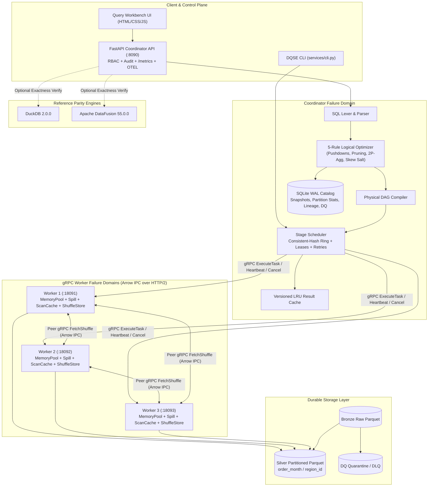

# Architecture Diagrams & Failure Domains

## Component & Failure-Domain Architecture

## Failure Domain Isolation

1. **Worker Process Crash (`SIGKILL`):** Isolated to a single worker process. Coordinator catches gRPC `UNAVAILABLE`, evicts the worker from the `ConsistentHashRing`, and retries affected stage tasks on surviving preference-list workers with a fresh `lease_id` and incremented `attempt`.
2. **Memory Exhaustion on a Worker:** Confined to the task's `MemoryPool`. Exceeding budget triggers partitioned Arrow IPC spill-to-disk in `spill_dir/<query_id>/<task_id>/` instead of OOM-killing the worker process; spill files are removed in `finally`.
3. **Corrupt Data Fragment:** Rejected by `validate_and_quarantine_parquet_file` before snapshot commit, isolating bad files in `quarantine/` while keeping active table snapshots consistent.
4. **Stale Cache Risk:** Mitigated via immutable snapshot versions in `Catalog` + `table_versions` validation on every cache lookup + synchronous `InvalidateCache` RPC broadcast on mutation.
