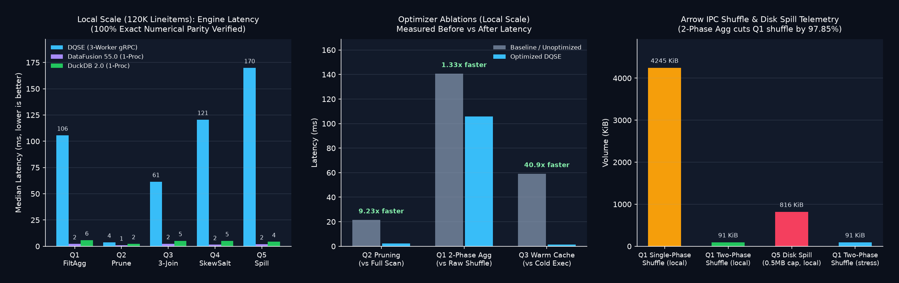

# Benchmark Report: DQSE vs. DuckDB 2.0.0 & Apache DataFusion 55.0.0

## Hardware & Software Environment

- **Machine:** Apple Silicon `arm64`, 14 CPU cores, 48.0 GiB RAM (`Darwin 24.6.0`)
- **Runtime:** Python `3.12.8`, `pyarrow==25.0.1`, `grpcio==1.85.1`, `duckdb==2.0.0`, `datafusion==55.0.0`
- **Cluster Topology:** 1 Coordinator + 3 independent gRPC Worker processes (`127.0.0.1:18291..18299`), 6 shuffle partitions, cold cache per benchmark iteration.
- **Reproduce Command:** `uv run python benchmarks/run_benchmarks.py`
- **Raw Outputs:** [`results/benchmarks/benchmark_results.json`](../../results/benchmarks/benchmark_results.json), [`results/benchmarks/benchmark_results.csv`](../../results/benchmarks/benchmark_results.csv), [`results/benchmarks/ablation_results.json`](../../results/benchmarks/ablation_results.json)

## Dataset Scales (Clean-Room Synthetic Order Analytics)

| Profile | `orders` Rows | `lineitem` Rows | `customer` Rows | `nation` Rows | Iterations |
| :--- | :---: | :---: | :---: | :---: | :---: |
| `smoke` | 2,000 | 5,907 | 200 | 12 | 3 |
| `local` | 30,000 | 120,209 | 2,000 | 12 | 3 |
| `stress` | 120,000 | 479,147 | 8,000 | 12 | 2 |

## Head-to-Head Latency & Exactness Parity (`local` Scale — 120,209 Lineitems)

| Query | DQSE p50 (ms) | DQSE p95 (ms) | DataFusion 55.0 p50 (ms) | DuckDB 2.0 p50 (ms) | Parts Pruned | RG Pruned | Shuffle (KiB) | Spilled (KiB) | Parity vs DuckDB & DataFusion |
| :--- | :---: | :---: | :---: | :---: | :---: | :---: | :---: | :---: | :---: |
| `Q1` Filtered Agg | 105.6 | 105.8 | 2.2 | 5.8 | 5/30 | 1 | 91.4 | 0 | Exact Match |
| `Q2` Pruned Point | **3.7** | 3.7 | 1.0 | 2.4 | **29/30** | **2** | 0 | 0 | Exact Match |
| `Q3` 3-Table Join | 61.5 | 61.5 | 2.4 | 5.2 | 20/36 | 2 | 1,010.7 | 0 | Exact Match |
| `Q4` Skew Salted Agg | 120.6 | 134.8 | 1.5 | 5.1 | 0/30 | 0 | 1,226.2 | 0 | Exact Match |
| `Q5` Low-Mem Spill (`0.5 MiB` cap) | 169.9 | 176.2 | 2.0 | 4.2 | 12/30 | 0 | 842.2 | **816.1** (72 files) | Exact Match |

## Head-to-Head Latency & Exactness Parity (`stress` Scale — 479,147 Lineitems)

| Query | DQSE p50 (ms) | DQSE p95 (ms) | DataFusion 55.0 p50 (ms) | DuckDB 2.0 p50 (ms) | Parts Pruned | RG Pruned | Shuffle (KiB) | Spilled (KiB) | Parity |
| :--- | :---: | :---: | :---: | :---: | :---: | :---: | :---: | :---: | :---: |
| `Q1` Filtered Agg | 295.6 | 295.7 | 3.2 | 6.5 | 5/30 | 0 | **91.4** | 0 | Exact Match |
| `Q2` Pruned Point | **4.0** | 4.1 | 1.1 | 2.5 | **29/30** | **2** | 0 | 0 | Exact Match |
| `Q3` 3-Table Join | 86.8 | 87.2 | 2.8 | 5.7 | 20/36 | 0 | 3,734.3 | 0 | Exact Match |
| `Q4` Skew Salted Agg | 298.3 | 299.7 | 2.1 | 5.4 | 0/30 | 0 | 4,403.2 | 0 | Exact Match |
| `Q5` Low-Mem Spill (`2.0 MiB` cap) | 515.7 | 517.5 | 3.0 | 4.9 | 12/30 | 0 | 3,111.1 | **3,085.0** (72 files) | Exact Match |

## Honest Interpretation of Reference Comparisons

Single-process native C++ (DuckDB 2.0.0) and Rust (DataFusion 55.0.0) engines are substantially faster than DQSE on local datasets that fit inside single-machine RAM (`1–6 ms` vs `4–516 ms`), because they execute directly in shared memory without gRPC HTTP/2 transport, Arrow IPC stream framing, multi-stage task scheduling, or Python row-level hash-table accumulation.

On `Q2`, where partition pruning skips 29 of 30 partitions and row-group statistics prune 2 of 5 row groups with zero shuffle, DQSE achieves `3.7 ms` (`local`) and `4.0 ms` (`stress`), within `1.5–1.6×` of DuckDB 2.0.0 (`2.4–2.5 ms`).

## Measured Optimizer Ablations (`local` Scale)

| Experiment | Baseline (Unoptimized) | Optimized DQSE | Measured Delta (vs. Baseline) | Exact Match |
| :--- | :---: | :---: | :---: | :---: |
| `Q2` Partition + Row-Group + Projection Pruning | 21.38 ms (30,000 rows) | **2.32 ms** (491 rows) | **9.23× faster**, 98.4% fewer rows scanned | Yes |
| `Q1` Two-Phase Partial/Final Agg vs. Single-Phase Raw Shuffle | 140.58 ms (4,244.7 KiB shuffle) | **105.70 ms** (**91.4 KiB** shuffle) | **97.85% less shuffle traffic**, 1.33× faster | Yes |
| `Q3` Warm Versioned LRU Cache vs. Cold Distributed Execution | 59.04 ms (cold) | **1.45 ms** (warm hit) | **40.9× faster** on repeated snapshot | Yes |
| `Q5` Tight-Memory Spill (`0.5 MiB` cap) vs. Unconstrained In-Memory | 113.14 ms (0 B spilled) | 181.06 ms (816.1 KiB spilled, 72 files) | +60% latency trade for hard `0.5 MiB` ceiling | Yes |
| `Q4` Skew-Aware Salted Shuffle (`factor=4`) vs. Unsalted 2-Phase | 105.61 ms (2 stages) | 119.04 ms (3 stages) | +12.7% overhead on small data to eliminate single-worker skew hotspot | Yes |
